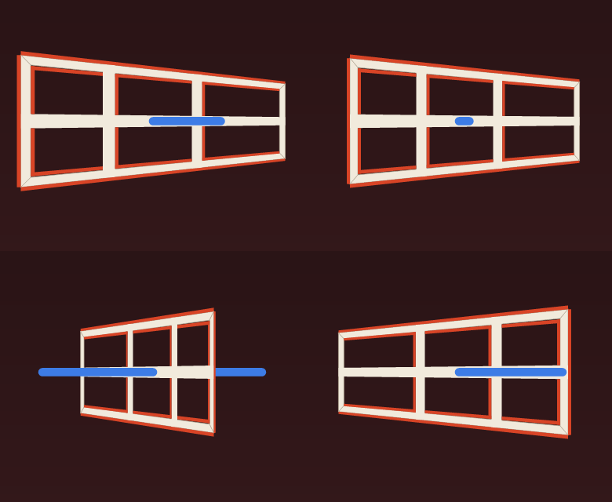

# Ames Window

**Try it in the browser:** https://brucedombrowski.github.io/Ames-Window/

A pure‑Rust app that performs the **Ames window illusion**: a flat trapezoid,
painted like a six‑pane window in perspective, that spins full circle but
appears to swing back and forth. A blue pen through its centre seems to bend
and pass through solid wood.

It is written for iOS, but the same code also builds for the desktop and for
the browser. See [Status](#status) for what has actually been run where.



Tap the screen (or click it) to reveal a small dial: a bird's‑eye view. The
thin pale bar with a dot on its tall end is what the window is *really* doing,
and the blue line through it is the pen, fixed to the window and turning with
it. The thick amber bar behind them is what your eye insists the window is
doing; its dot, the believed tall end, stays on the viewer's side while the
pale dot goes all the way round. Tap again to hide the dial and let the
illusion back in.

New to Rust? Start with [docs/tour.md](docs/tour.md), a file‑by‑file reading
order that introduces one idea at a time.

## Layout

| Path | What it is |
|---|---|
| `crates/ames-core` | The geometry. No dependencies, no pixels. Trapezoid, painted reveals, pen, camera, rotation, projection, and the perceived‑angle model. Every module has unit tests. |
| `crates/ames-app` | The application, binary name `ames-window`. `winit` for the window and input, `tiny-skia` to rasterise on the CPU, `softbuffer` to present. One source tree for every platform; the only platform‑specific code is the entry point and the clock on wasm, and `ios_scene.rs` on iOS. |
| `crates/ames-app/examples/snapshot.rs` | Renders frames to PNG without opening a window. |
| `web/index.html`, `scripts/web.sh` | The browser shell and the build script that produces `web/dist`. |
| `ios/Info.plist`, `scripts/ios.sh` | The iOS bundle metadata and the build‑sign‑install script. |
| `.github/workflows/ci.yml` | CI: formatting, clippy and tests on every pull request; checks that the wasm and Windows targets compile. |
| `.github/workflows/pages.yml` | CI: tests, builds the wasm, deploys to GitHub Pages. |
| `.github/workflows/release.yml` | CI: on a `v*` tag, builds and seals the release. See [Releasing](#releasing). |
| `.github/workflows/security.yml` | CI: SBOM and verification‑matrix drift checks, `cargo deny`, and a grep for socket code. Runs on pushes to `main`, pull requests, weekly, and by hand. |
| `deny.toml`, `sbom.cdx.json` | Dependency policy and the committed CycloneDX bill of materials. See [Supply chain](#supply-chain). |
| `scripts/no-network.sh`, `scripts/malware.sh` | Prove the compiled module imports no network API; scan files for known malware with ClamAV. |
| `scripts/sbom.sh`, `scripts/svd.sh`, `scripts/ver.sh` | Regenerate the SBOM, write a Software Version Description, regenerate the verification matrix. |
| `scripts/release.sh` | Bump the version, close the changelog, commit and tag. |
| `CHANGELOG.md` | Keep a Changelog format. |
| `docs/` | Preview images, the tour, and the compliance documents listed below. |

There is no Swift, no Objective‑C, no Xcode project and no GPU code. `ames-core` is
`#![forbid(unsafe_code)]`; `ames-app` is `#![deny(unsafe_code)]` with one
exception, `ios_scene.rs`, which calls UIKit to put the window on screen. On
Apple platforms the Objective‑C runtime is reached through the `objc2`
bindings that `winit` and `softbuffer` depend on.

The app has no network capability of any kind and never will. See
[Supply chain](#supply-chain).

## Requirements

- Rust **1.87 or newer**, declared as `rust-version` in `Cargo.toml`. The
  workspace uses edition 2024 and `u128::is_multiple_of`; 1.86 fails to
  compile.
- `python3`, used by both scripts (`web.sh` to serve locally, `ios.sh` to read
  simulator and profile data).
- For the web: the `wasm32-unknown-unknown` target and `wasm-bindgen-cli`
  **0.2.130** exactly, matching the pinned `wasm-bindgen` crate.
- For iOS: a Mac with full Xcode (the script calls `simctl`, `codesign`
  and `devicectl`) and the `aarch64-apple-ios` and `aarch64-apple-ios-sim` targets.

## Splash screen

The app opens with `Hello, world!`, lettered in a five‑by‑seven dot font
defined in `font.rs`, cursor blinking. It holds for 1.8 s, then dissolves into
the window over 0.7 s.


## Controls

Touch and the left mouse button are handled the same way.

| Input | Effect |
|---|---|
| Tap / click | Show or hide the dial that reveals the true rotation |
| Drag left or right | Turn the window by hand (spinning pauses while you hold it) |
| `Space` | Show or hide the dial |
| `X` | Toggle the pen |
| `R` | Reverse the spin |

The keys need a keyboard, so in practice they are desktop and browser only.

## Build

```sh
cargo test --workspace                 # 24 core tests, 23 app tests, 1 doctest
cargo run -p ames-app                  # desktop window; needs a display
cargo run -p ames-app --example snapshot -- out
```

The snapshot example writes six PNGs into `out/`: `ames-splash.png`, plus
`ames-000.png`, `ames-030.png`, `ames-060.png`, `ames-120.png` and
`ames-150.png` at those rotation angles, with the dial shown.

### Web

```sh
rustup target add wasm32-unknown-unknown
cargo install wasm-bindgen-cli --version 0.2.130 --locked
scripts/web.sh            # builds web/dist
scripts/web.sh serve      # builds, then serves http://localhost:8000
```

The `Pages` workflow runs `cargo test --workspace`, builds the wasm, and
deploys `web/dist` to GitHub Pages. It triggers on pushes to `main` and can be
started by hand from the Actions tab. Deploys from branches other than `main`
have failed at the deploy job; from `main` the deploy succeeded on
2026‑11‑11, so the app is at:

https://brucedombrowski.github.io/Ames-Window/

Every frame is rasterised on the CPU, so the browser build is tuned to stay
smooth on slow machines:

- It is compiled with 128‑bit WebAssembly SIMD (`.cargo/config.toml`), which
  current browsers support (Safari from 16.4). Measured in headless Chrome on an M2 Max at
  1920x1080, that alone took the page from 30 to 60 frames a second.
- The backdrop is painted once per size and copied in each frame.
- It draws at most 1440 pixels on the longest edge and lets the browser scale
  the canvas up. `budget.rs` times each frame, and when frames take longer
  than 11 ms it lowers that limit step by step, down to 480 pixels.

The page shows its measured frame rate in the bottom right corner beside a
**Report feedback** link. The link opens GitHub's new‑issue form filled in
with the frame rate, sizes, browser and build commit. It is an ordinary link
in `web/index.html`. Those measurements are in the link's address, so they go
to GitHub when the viewer follows it, and become public only if the viewer
submits the form. Until the link is followed the page sends nothing.

Known gaps in the web build are tracked in issue #4: the wasm is about 1 MB
unoptimised, and touch on a real phone browser has not been confirmed.

### iOS

```sh
rustup target add aarch64-apple-ios aarch64-apple-ios-sim
scripts/ios.sh sim        # build, bundle, install and launch in the simulator
scripts/ios.sh device     # build, sign, install and launch on a plugged‑in iPhone
```

What the script does:

1. `cargo build --release` for the chosen target.
2. Copies the binary and `ios/Info.plist` into `target/ios/<kind>/Ames Window.app`.
3. Simulator: boots an iPhone simulator if none is running, installs, launches.
4. Device: takes the provisioning profile named by `PROVISIONING_PROFILE`, or
   finds a valid one covering `com.brucedombrowski.ames-window`; embeds it,
   signs with its entitlements (using `CODESIGN_IDENTITY` or the first "Apple
   Development" identity), then installs and launches with `devicectl`.

`ios/Info.plist` declares a `UIApplicationSceneManifest`, and
`crates/ames-app/src/ios_scene.rs` puts the window on the scene it names.
Both are required on iOS 13 and later: without the manifest, iOS 26 and newer
stop the app at launch; without the scene, the window is never shown and the
screen stays black. See the header of `ios_scene.rs` for the detail. This
replaces an earlier workaround that rewrote the binary's recorded SDK version
with `vtool`.

A device needs a provisioning profile for that bundle id. Xcode mints one the
first time you run any project with that bundle id and your team on the phone;
after that the script finds it on its own. To choose one yourself, point
`PROVISIONING_PROFILE` at it. Either way the entitlements are read back out of
the profile, so the two cannot drift apart:

```sh
CODESIGN_IDENTITY="Apple Development: you (TEAMID)" \
PROVISIONING_PROFILE=~/Library/MobileDevice/Provisioning\ Profiles/your.mobileprovision \
  scripts/ios.sh device
```

Keep that profile outside the repository: it carries your team ID and the UDID
of every registered device. `.gitignore` refuses `*.mobileprovision` for you.

## Status

What has been verified, as of 2026‑11‑11 (details in issues #2 and #4):

| Target | State |
|---|---|
| Linux | `cargo test --workspace` passes. The windowed app has not been run (no display in CI). |
| Browser | Built in CI and deployed to Pages from `main`. Checked earlier in headless Chromium at phone size: splash, fade, spin, no console errors. Not yet tried on a real phone browser. |
| macOS | `cargo test --workspace` passed on a Mac. The windowed app has not been reported run. |
| iOS simulator | The app used to install, launch, then crash at once under iOS 27. It now declares a scene manifest and adopts the scene (`ios_scene.rs`); commit `64595f7` records it running on an iPhone 18 Pro simulator: splash, then the window and pen, animating. |
| iPhone | Install previously failed for want of a provisioning profile. Not yet run. |
| Windows | `cargo check --target x86_64-pc-windows-msvc` passes, on a Mac and in CI. Never linked or run natively; the browser build is what a Windows machine has run. |

## Compliance documentation

The process follows a systems engineering process framework maintained
separately, and cites only openly published standards.

| Document | What it is |
|---|---|
| [`docs/standards.md`](docs/standards.md) | Governing standards register: NIST, FIPS, NTIA, ECMA, MIL-STD-498, BCP 14. What applies, what does not, and why. |
| [`docs/REQ-2026-001.json`](docs/REQ-2026-001.json) | Requirements, BCP 14 keywords, each citing a standard and section, with evidence anchors. |
| [`docs/VER-2026-001.md`](docs/VER-2026-001.md) | Verification matrix, generated by `scripts/ver.sh` from those anchors. CI fails if it drifts from the code. |
| [`docs/configuration-management.md`](docs/configuration-management.md) | CM plan: baselines, change classes, roles, process, what tools enforce versus what people own. |
| `docs/DM-2026-*.md` | Decision memoranda: options considered, decision, rationale with standard references. |
| [`CHANGELOG.md`](CHANGELOG.md) | Keep a Changelog format, Semantic Versioning. |

## Supply chain

This repository is an IT security compliance demonstration for an
application. The application is deliberately trivial so that the process
around it is the subject. One rule follows from that and is permanent: **the
application never has network capability.** No telemetry, analytics, crash
reporting or update checks, inbound or outbound. Checked on 2026‑11‑11: no
networking crate is in `Cargo.lock` and the source uses no sockets. The
dependency policy rejects any component that could provide it, the
`Supply chain` workflow greps our own source for socket code, and every
Software Version Description states the claim. See issue #8.

The web page carries one outbound link, **Report feedback**, which opens a
pre‑filled GitHub issue form in a new tab, carrying the page's measurements
in its address. That is navigation the viewer chooses, not a capability of
the application: the page and the wasm module make no request of their own,
and the `Supply chain` workflow greps `web/` as well as `crates/` to keep it
so. The owner asked for the link; it is not telemetry, because nothing is
sent without the viewer acting.

`sbom.cdx.json` is a [CycloneDX](https://cyclonedx.org) 1.6 Software Bill of
Materials listing every crate the binary depends on, for every target, with
versions, licences and the dependency graph. It is generated from `Cargo.lock`
by `scripts/sbom.sh` and is byte-for-byte reproducible, so it lives in git and
the `Supply chain` workflow fails if it ever drifts from the lockfile. The
script rewrites the absolute path `cargo-cyclonedx` records for the
workspace's own crates to a fixed `path+file:///src/` prefix; without that
the file differed between machines, which is why the workflow's first run on
`main` failed.

Three questions a security review asks, and what answers each:

| Question | Checked by | When |
|---|---|---|
| Known vulnerabilities | `cargo deny check` against the RustSec advisory database; GitHub Dependabot alerts against the GitHub Advisory Database | Every push to `main`, every pull request, weekly; Dependabot continuously |
| Malware | `scripts/malware.sh` (ClamAV, signatures refreshed each run) over our source, every component's source, and the built bundle | Source and components: every push, pull request, weekly. Bundle: before every deploy |
| Network capability | Crate bans and feature denials in `deny.toml`; a grep of `crates/` and `web/`; `scripts/no-network.sh`, which reads the compiled module's import list and fails on any network API | Every push and pull request, and on the built bundle before every deploy |

What these do not show. A scan finds what is already known: a clean result
means no match on that date, not that a file is benign or a component free of
undisclosed flaws. A WebAssembly module can call only what it imports, so the
import list is a complete account of the module, but not of the page around
it: the page's one outbound link is described above. A program with its own
approved scanners runs them on delivery; the SBOM exists so that it can.

`deny.toml` is the policy: `cargo deny check` fails on known vulnerabilities,
licences outside the permissive allowlist, wildcard versions, or crates from
anywhere other than crates.io. One advisory is explicitly ignored with a
reason in the file: RUSTSEC‑2026‑0192, `ttf-parser` unmaintained, reached only
through `winit` (issue #6). The same workflow runs the check on every push to
`main` and weekly, so new advisories surface without a code change. The
workflow's latest result is on the Actions tab; it was first merged to `main`
on 2026‑11‑11.

`scripts/svd.sh` writes a Software Version Description to `target/svd/`,
following MIL-STD-498 (DI-IPSC-81442) section by section: materials released,
every source file and third-party component with checksums, changes since the
last release, installation steps and known problems. It is generated entirely
from the repository at the current commit, so it is never written by hand and
never out of date. CI attaches it beside the SBOM on every run.

```sh
cargo install cargo-cyclonedx --version 0.5.10 --locked
cargo install cargo-deny --locked
scripts/sbom.sh           # regenerate after changing dependencies
cargo deny check          # vulnerabilities, licences, bans, sources
scripts/svd.sh            # Software Version Description for this commit
scripts/svd.sh --from v1.0.0   # ...for a recipient still running v1.0.0
```

An SVD is written for whoever receives the software. If a site is on 1.0 and
is being given 1.4, its "changes installed" section must cover 1.0 to 1.4,
including the 1.1 through 1.3 releases that site never installed. `--from`
takes the tag or commit the recipient has; the skipped releases are listed.

## Releasing

No version has been released yet. The procedure, from
[`docs/configuration-management.md`](docs/configuration-management.md):

1. The release authority approves the version (a Major change).
2. On a clean `main`: `scripts/release.sh vX.Y.Z` bumps `Cargo.toml`,
   `Cargo.lock` and `ios/Info.plist`, turns the changelog's Unreleased
   section into the version's section, commits and tags. Add `--dry-run` to
   see the diff first.
3. `git push origin main vX.Y.Z`.
4. The `Release` workflow tests, checks the SBOM and verification matrix,
   builds `ames-window-web.zip`, generates the Software Version Description
   at the tagged commit, writes `SHA256SUMS`, signs a build‑provenance
   attestation, and creates the GitHub Release carrying all of them. It then
   opens a pull request that files the SVD under `docs/releases/`.
5. After a delivery or installation, update `deployments.toml` (issue #10).

The workflow has not run yet, because there is no tag; the dry run of the
script has.

## Why it works

The brain assumes the taller edge of the trapezoid is nearer, because that is
what a real rectangle would look like in perspective. While the tall edge is in
fact nearer, perception and reality agree. For the other half of each turn the
tall edge is behind, and a flat picture cannot say so: the same outline fits a
window turned the opposite way with its tall edge in front, and that is the
one the brain picks. So the believed window never completes a turn. Its tall
edge sweeps across in front and back again while the real one goes all the way
round. `ames_core::perceived_angle` is that rule as a single `if`. The red strips on the frame are the painted thickness
of a real window, not shadows; they are what sells the depth.

## License

Licensed under either of the [MIT license](LICENSE-MIT) or the
[Apache License, Version 2.0](LICENSE-APACHE), at your option. This is the
convention across the Rust ecosystem, so the code can be used anywhere other
Rust crates can.
